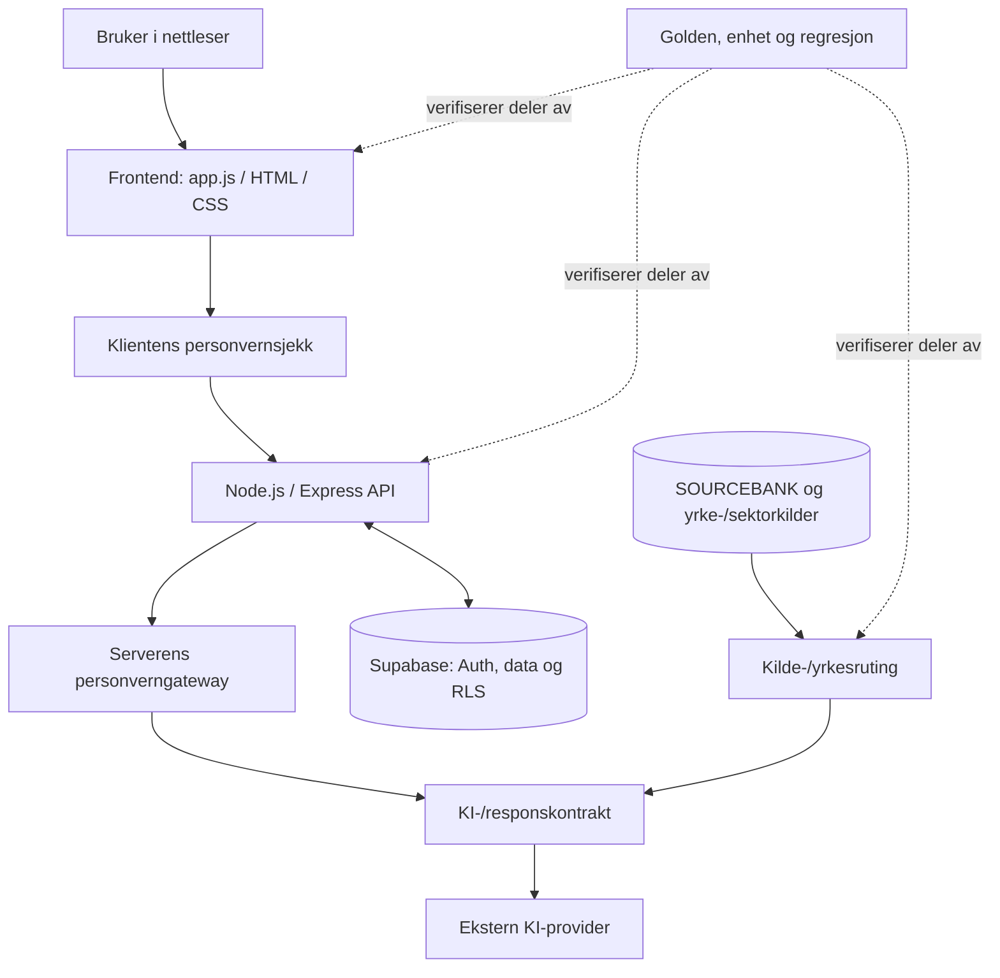
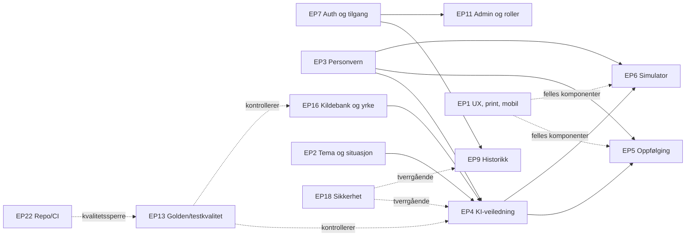

# Arkitektur- og avhengighetskart – Samtalestøtte

> **Statuskontroll 25.11.2026:** Arkitekturdiagram og avhengigheter er historisk kontrollert på eldre SHA. `main` er nå `61d282dc` før dokumentasjonsrevisjonen; LIVE/tale er fortsatt eksperimentelt. Gjeldende kode/Render: `61d282dc`, [Quality Gate](https://github.com/IBE160-2026/G46-nilsen/actions/runs/45662862335) = grønn, Render = `live` før denne dokumentasjonsrevisjonen. Se [prosjektstatus](../PROSJEKTSTATUS.md) og [revisjonsrapport](../DOKUMENTASJONSREVISJON-2026-11-25.md).

**Oppdatert:** 18.11.2026  
**Grunnlag:** Produksjonsgrenen `main` @ `2ae505adc22a9ea86ef89e5cf045f4ec5f68d0cf`.  
**Status:** Pedagogiske Mermaid-diagrammer over dokumenterte hovedkomponenter og viktige **logiske** avhengigheter. Dette er **ikke** et maskinelt generert eksakt kall-/avhengighetstre eller dokumentasjon av full vertikal-slice-isolasjon.

Forelesningen 12. november anbefaler å illustrere **epics → stories → avhengigheter/sprintplan** for å se hvilke oppgaver som kan tas separat, og hvor endringer kan gi følgefeil. Diagrammene under brukes sammen med `PRD.md`, `ARCHITECTURE-BMAD.md` § 2.1, `EPICS-AND-STORIES-BMAD.md` og testregisteret. Mermaid er tekstbasert og kan vedlikeholdes i Git.

## 1. Faktisk hovedarkitektur – forenklet

**Tillitsgrense:** Frontendens PII-varsel er ikke en sikkerhetsbarriere alene. Direkte API-kall kan omgå klienten; serversiden må kontrollere før eksterne KI-kall. RLS og tilgangskontroll verifiseres separat med autentisert/ikke-autentisert testing. Diagrammet er forenklet og viser ikke hvert autentiserings- eller simuleringsendepunkt.

## 2. Epics og sentrale avhengigheter (logisk kontrollmodell)

Diagrammet viser **risiko for kobling og nødvendig logisk rekkefølge**, ikke at hver epic er en uavhengig kjørbar modul. Flere epics deler `server.js` og `app.js`, og noen tester er strukturelle. Endring i felles kode må derfor utløse relevante regresjonskontroller på tvers av epics.

## 3. En konkret story som ikke kan godkjennes alene

**EP16 / Story 16.3 (yrkeskilder)** bygger på korrekt kildebank/ruting. Den påvirker **EP4 (KI-veiledning)** og **EP13 (golden-evaluering)**. Dersom feil tariffkilde dukker opp, må vi undersøke om årsaken er registreringsdata, ruting, instrukser til modellen eller en for rigid test. Derfor kreves både positive og negative `source_id`-forventninger (FR-15A), og 40/40 fra en tidligere live-kjøring beviser ikke enhver framtidig modellrespons.

**EP22 / Story 22.4 (CI)** kan blokkere hele sluttkontrollen selv om de øvrige enhetstestene har bestått. Dette skjedde 12.11 da lærerens `.docs/planning-artifacts/architecture/technology.md` ble møtt av repo-strukturtesten. Den bevisst smale testrettelsen må fortsatt gjennom full CI på endelig commit.

## 4. Utenfor dette kartet

- **FR-23:** en mulig alternativ direkte inngang uten full temameny, ikke fullført på `main`.
- **LIVE/tale:** separat eksperiment på `pilot-ux-v20.11` og pilot-Render, **ikke produksjonssatt**. Transkripsjon, talekommandoer, feilkorrigering og personvern må testes separat.
- **Lokal RAG / intern/offline KI:** framtidig målarkitektur, ikke del av den ferdige studentprototypen.

**Neste kontroller:** For å lage et *faktisk* graftrukket dependency-kart må modulimporter, API-kall, CSS-domener og databaseavhengigheter ekstraheres fra kode; diagrammet ovenfor er ikke et slikt automatisert uttrekk.
